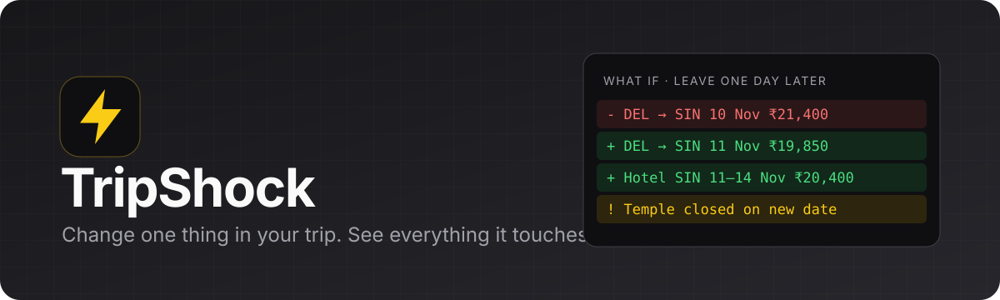

<p align="center">
  
</p>

<p align="center">
  <b>A dependency-aware "What if?" simulator for trips, powered by live SerpApi search data.</b>
</p>

<p align="center">
  
  
  
  
  
</p>

---

## About

**TripShock answers one question: _"If I change one thing in my trip, what else changes?"_**

It doesn't generate a trip for you. It takes a trip you already have, such as flights, hotels, activities and transfers, and models it as a **dependency graph**. When you ask a what-if like _"leave one day later"_ or _"one more night in Singapore"_, TripShock:

1. **branches** the plan (the original is never modified),
2. **propagates** the change through every dependent item,
3. **re-searches only the affected** flights and hotels using live Google Flights, Google Hotels and Google Maps data from SerpApi,
4. shows a **trip diff**, like a code diff, with price changes, conflicts and unknowns.

## The problem it solves

A travel plan is a coupled system. Moving one date can quietly change:

- the flight price and the next flight's departure,
- the number and dates of hotel nights, and whether the hotel is still available,
- whether an attraction is open on the new day,
- the order of activities and the airport transfers.

Today you have to redo every search by hand and work out the knock-on effects yourself. **TripShock makes those dependencies explicit** and recomputes them for you, using only current, sourced data.

| Without TripShock | With TripShock |
|---|---|
| Re-search every flight and hotel manually | Only affected items are re-searched |
| Easy to miss that the hotel now overlaps the next flight | Conflicts and broken dependencies are flagged |
| Prices from different tabs at different times | Every price has its source, exact query and timestamp |
| "Is this cheaper?" is guesswork | Side-by-side diff with the observed total change |

### Honesty by design

- Every price is an **observation**: engine, exact query, timestamp, the chosen option and why it was chosen. Click any price to see it.
- A hotel you named is **never silently swapped** for a different one.
- Failed searches show as **Unavailable** and are left out of totals. An old price is never shown as current.
- The copy says "observed change", never "you will save". Fares are not guaranteed.

## Quick start

**Requirements:** Node.js **22.13 or newer** (`node -v`). No database setup is needed; it uses Node's built-in SQLite.

```bash
git clone https://github.com/krakken190/Trip_Shock.git
cd Trip_Shock
npm install
npm run dev
```

Open **http://localhost:3000**.

Without any keys, TripShock runs on a **deterministic mock provider**, and every price is clearly labelled _Simulated_. To use live data:

```bash
cp .env.example .env.local
```

Then edit `.env.local`:

```ini
SERPAPI_API_KEY=your_serpapi_key          # live Google Flights / Hotels / Maps
OPENROUTER_API_KEY=your_openrouter_key    # optional: "Describe your trip" by voice or text
```

Restart `npm run dev` after changing `.env.local`.

## How to use

1. **Create a trip**
   - Click **Load the Delhi → Singapore → Bali demo** to try it in under a minute, **or**
   - **Describe your trip** by typing or using the mic, e.g. _"Pune to Goa with my wife on 12 Nov, business class, budget hotel 12–16 Nov, fly back on the 16th in the evening"_. Review the extracted items, fill anything shown in amber, then **Confirm**. **Or**
   - Build it manually in the **Baseline** tab (add flights, stays, activities and transfers; mark items as **Fixed** if they must not move).
2. **Check the baseline.** Prices are fetched automatically. Each one has a freshness dot (fresh < 1 h, aging < 6 h, stale). Click a price to see its evidence.
3. **Look at the dependencies** in the **Dependencies** tab to see how items are linked.
4. **Ask a what-if** in the **What if…** tab, for example:
   - `leave one day later`
   - `one more night in Singapore`
   - `move the SIN → DPS flight to 14 Nov`

   TripShock shows how it interpreted your request before running. Choose a policy: **Push later items** (later items shift too) or **Keep later dates** (the change is absorbed by the hotel stay).
5. **Read the diff**: moved items, per-item price changes, the observed total change, conflicts (e.g. a fixed item that couldn't move, or an attraction closed that day) and unknowns.
6. **Save scenarios** and come back later. They are recomputed against your current baseline and can be refreshed for new prices.

## Describe your trip (voice or text)

On the home page, or **Describe to add** inside a trip, travellers can say or type the whole trip in one go:

> Pune to Goa with my wife on 12 Nov, arrive before 2 pm, business class. Budget hotel 12–16 Nov. Something adventurous near Baga beach on the 14th, top 3 places. Taxi to the airport. Fly back on the 16th in the evening.

1. **Speech → text** uses the browser's speech recognition (Chrome/Edge; `en-IN`).
2. **Text → structure**: an OpenRouter model returns strict JSON (`src/server/llm.ts`, schema in `src/domain/trip-draft.ts`). It tries `OPENROUTER_MODEL` first, then each of `OPENROUTER_FALLBACK_MODELS`. Each model gets one retry on rate limits and a JSON-mode retry if structured output fails. The output is validated before use.
3. **Review**: every item shows the phrase it came from. Missing fields are amber, and one-click suggestions fill them from things the traveller did say (e.g. "fly on the Goa check-in date", "add a return flight"). Interests like "something adventurous near Baga" become real Google Maps results to pick from; the model never invents places.
4. **Confirm** → the trip is created, prices are searched, and what-if scenarios work as usual.

The model is told never to fill in anything that wasn't said: no invented dates, hotels, prices or times. Requests the planner can't represent (seat preference, "estimate my costs") are listed back to the user as *heard but not planned*.

What the planner does with the extracted details:

| Said | Stored as | Effect on searches |
|---|---|---|
| "arrive before 2 pm", "evening flight" | flight `timePreference` | Google Flights `outbound_times` + selection prefers options inside the window (flags when none fit) |
| "business class" | flight `cabin` | `travel_class` |
| "budget hotel", "luxury", "under ₹3,000 a night" | stay `budget.tier` / `budget.maxPerNight` | hotel filters + cheapest option matching the tier; a stated cap is a hard limit |
| "taxi to the airport" | transfer → linked *before* the departure | no data source (your estimate) |

## What's in the MVP

| Spec P0 item | Where |
|---|---|
| Manual trip builder, fixed/flexible items | Baseline tab (`components/baseline-tab.tsx`, `node-editor.tsx`) |
| Baseline snapshot + revisions | `server/repo.ts` — every edit bumps `revision`; scenarios record the revision they branched from |
| Dependency graph | `domain/graph.ts#buildEdges` — derived deterministically from the timeline |
| Scenario ops: shift trip · resize stay · move flight | `domain/propagate.ts` |
| Impact propagation (+ "push later items" / "keep later dates" policy) | `domain/propagate.ts` |
| Current flight & hotel refresh | `providers/serpapi` → Google Flights / Google Hotels |
| Affected-only refetch | `domain/affected.ts#planRefresh` |
| Side-by-side diff, change log, impact summary | What-if tab (`scenario-result.tsx`) |
| Stale-data timestamps | Every price carries observed time + a freshness dot (fresh < 1h, aging < 6h, stale) |
| Partial failure handling | Failed searches are recorded as `error` evidence, priced as *Unavailable*, and excluded from totals with an explicit note |
| Scenario save/restore | Scenarios persist as operations + evidence and are recomputed against the current baseline |

The following P1 items are also included:
- **Natural-language scenario parsing** (`domain/parse.ts`). It is deterministic and local, and it always shows its structured interpretation before a run.
- **Attraction opening-day constraints**, taken from Google Maps hours. They are enforced only when evidence exists.
- **Dependency inspector graph**, with the propagation path animated.

## Architecture

```
src/
  domain/        Pure, framework-free logic (unit-tested)
    types.ts       zod schemas: Trip, nodes, edges, operations, observations
    graph.ts       builds dependency edges from the timeline
    propagate.ts   applies operations + propagates date changes (deterministic)
    affected.ts    search keys → which nodes must be re-searched
    constraints.ts conflict detection (gaps, overlaps, fixed nodes, closed days)
    diff.ts        node / field / aggregate diff
    select.ts      picks the option representing a node (pinned flight, named hotel …)
    parse.ts       natural language → operations
  providers/     The only code that knows provider JSON shapes
    serpapi/       client (timeouts, retries, backoff) + normalizers
    mock.ts        deterministic simulated provider
  server/        Persistence + orchestration
    db.ts / repo.ts  SQLite (trips, scenarios, observations, settings)
    refresh.ts       observe nodes: cache → provider → evidence record
    service.ts       baseline & scenario views, API use-cases
  app/api/       Route handlers (thin)
  components/    UI
```

### Propagation rules

- Flights, activities and transfers are **rigid**. Moving one end moves the other.
- Stays are **elastic**:
  - When a stay is reached at check-out (from a later flight), it stretches or shrinks.
  - When it is reached at check-in (from an earlier flight), it shifts whole under the *push later items* policy, or absorbs the change under *keep later dates*.
- Spine edges (flight ⇄ stay) are two-way couplings. Activity and transfer edges are one-way: they follow their host.
- **Fixed** nodes never move automatically. A push into a fixed node is recorded as *held*, and the broken edge surfaces as a conflict with a suggestion.
- Scenarios never mutate the baseline. They store operations plus their own evidence, and they are recomputed on read.

### Evidence and honesty rules

- Every price is an *observation*: provider, engine, exact params, timestamp, the chosen option and why it was chosen. Click any price to open it.
- A named hotel is never silently swapped for a different one. If it isn't in the results, the price is "not found for these dates".
- An `error` observation replaces the previous one, so an old price is never shown as current. The last successful price appears only as a clearly labelled "last known".
- Totals sum only nodes with known before and after prices. Anything else is listed as excluded.
- The copy uses "observed" and "estimated from current results", never "you will save".

## API

```http
GET    /api/trips                     list
POST   /api/trips                     TripInput | { "sample": true }
GET    /api/trips/{id}                baseline view (trip, evidence, conflicts, scenarios)
PUT    /api/trips/{id}                replace baseline plan (new revision)
POST   /api/trips/{id}/refresh        { nodeIds? } — force fresh searches
POST   /api/trips/{id}/scenarios      { ops, policy?, name? } or { prompt }  (?refresh=0 to skip searches)
GET    /api/scenarios/{id}            full scenario view
GET    /api/scenarios/{id}/diff       { aggregate, fields, conflicts }
POST   /api/scenarios/{id}/refresh    { force? } — re-search affected nodes
DELETE /api/scenarios/{id}
GET    /api/evidence/{id}             observation + trimmed provider metadata
POST   /api/dev/faults                mock only: { flights|hotels|places: "error"|"empty" }
```

Example:

```bash
curl -X POST localhost:3000/api/trips/<id>/scenarios -H 'content-type: application/json' \
  -d '{"ops":[{"op":"shift_trip","days":1}]}'
```

## Tests

```bash
npm test          # domain + service tests (incl. spec E2E-01…05 at the service layer)
npm run e2e       # Playwright UI tests for E2E-01…05 (builds and starts on :3100)
npm run test:live # opt-in live SerpApi test — needs SERPAPI_API_KEY, spends credits
```

## Configuration

| Variable | Default | |
|---|---|---|
| `SERPAPI_API_KEY` (or `SERPAPI_KEY`) | — | Enables live data |
| `TRIPSHOCK_PROVIDER` | `serpapi` if key set, else `mock` | Force a provider |
| `TRIPSHOCK_DB` | `data/tripshock.db` | SQLite path (`:memory:` for tests) |
| `TRIPSHOCK_CACHE_TTL_MIN` | `30` | Reuse an identical successful search younger than this |
| `TRIPSHOCK_MOCK_LATENCY_MS` | `250` | Simulated provider latency |
| `OPENROUTER_API_KEY` | — | Enables "Describe your trip" |
| `OPENROUTER_MODEL` | `qwen/qwen3.8-27b:free` | Primary extraction model |
| `OPENROUTER_FALLBACK_MODELS` | — | Comma-separated fallbacks, tried in order |

## Known limits / next steps

- Scenarios take one operation from the UI (the API accepts up to 10, applied in order).
- Transfers have no data source; they carry user estimates only.
- Not yet built: flexible-date deal suggestions (Google Flights Deals / Travel Explore), a "cheapest shift within ±N days" optimizer, and multi-scenario comparison.
- Weather is out of scope, per the spec.
